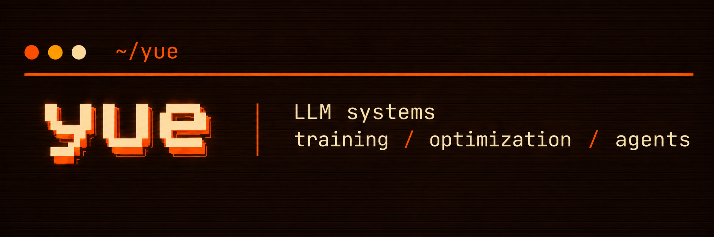

  <a href="#research-interests">Research</a> &nbsp;·&nbsp;
  <a href="#selected-work">Projects</a> &nbsp;·&nbsp;
  <a href="#background">Background</a>

 

### I work on training and improving language models.

Agentic RL, distributed training, optimization, and self-improving agents.

 

## Research interests

- **Agentic RL** — policy optimization, reward design, and evaluation.
- **Distributed training** — FSDP2, rollout pipelines, and GPU / NPU systems.
- **Optimization** — optimizers, low-rank updates, and memory–throughput trade-offs.
- **Self-improving agents** — execution feedback and controlled evaluation.

 

## Selected work

### [sft-autoresearch](https://github.com/yue-zeng-yue/sft-autoresearch)

A bounded SFT configuration and evaluation loop built around ms-swift.

### [rsi-research-hub](https://github.com/yue-zeng-yue/rsi-research-hub)

Literature, hypotheses, benchmark design, and reproducibility protocols.

### RL training frameworks

[**verl**](https://github.com/verl-project/verl) · [**OpenRLHF**](https://github.com/OpenRLHF/OpenRLHF) · [**slime**](https://github.com/THUDM/slime) · [**SkyRL**](https://github.com/skyrl-project/SkyRL)

Community-developed frameworks. My working fork: <a href="https://github.com/yue-zeng-yue/verl">verl</a>.

 

## Background

M.IT · University of New South Wales 
LLM Algorithm Engineer · CMB

---

Python · PyTorch · Ray · vLLM · FSDP2
